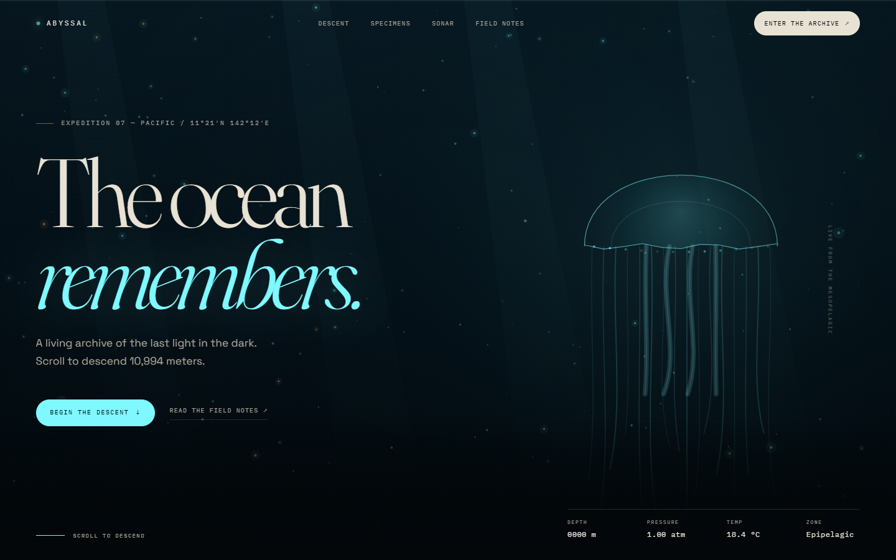
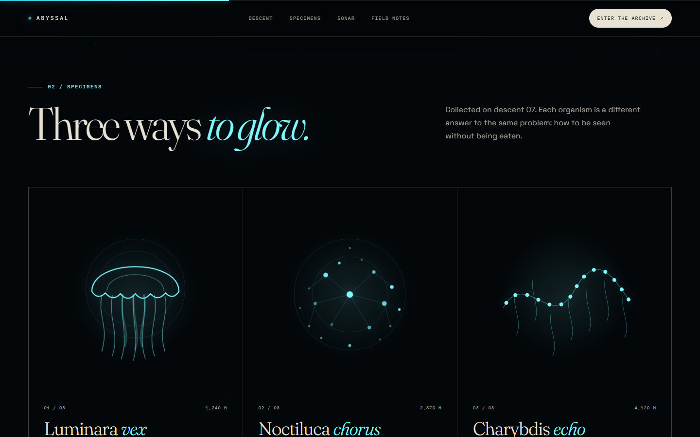
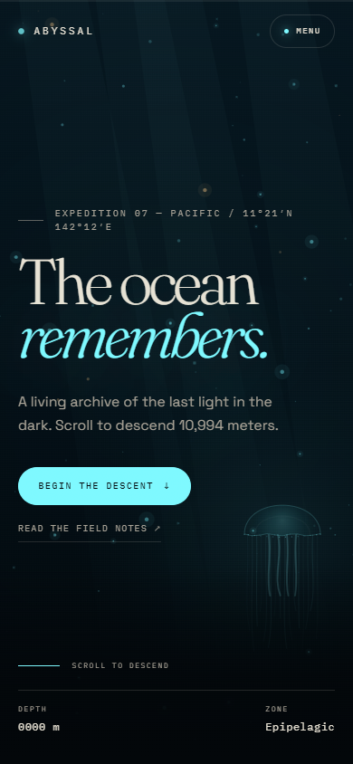
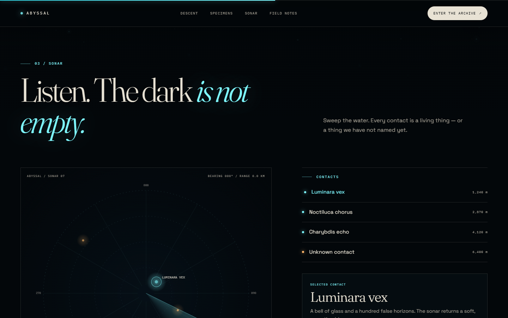
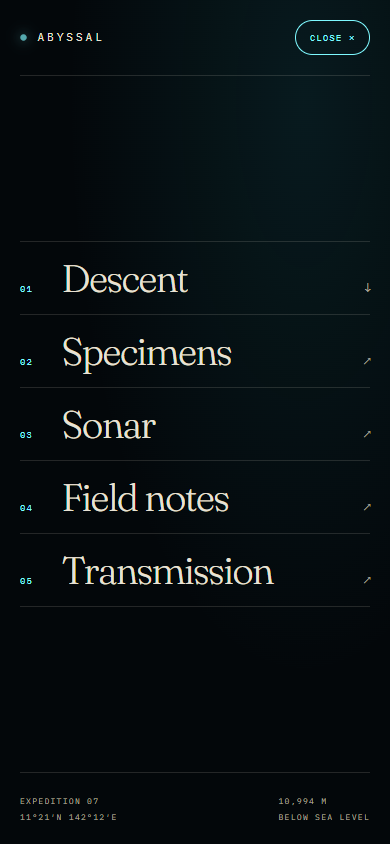
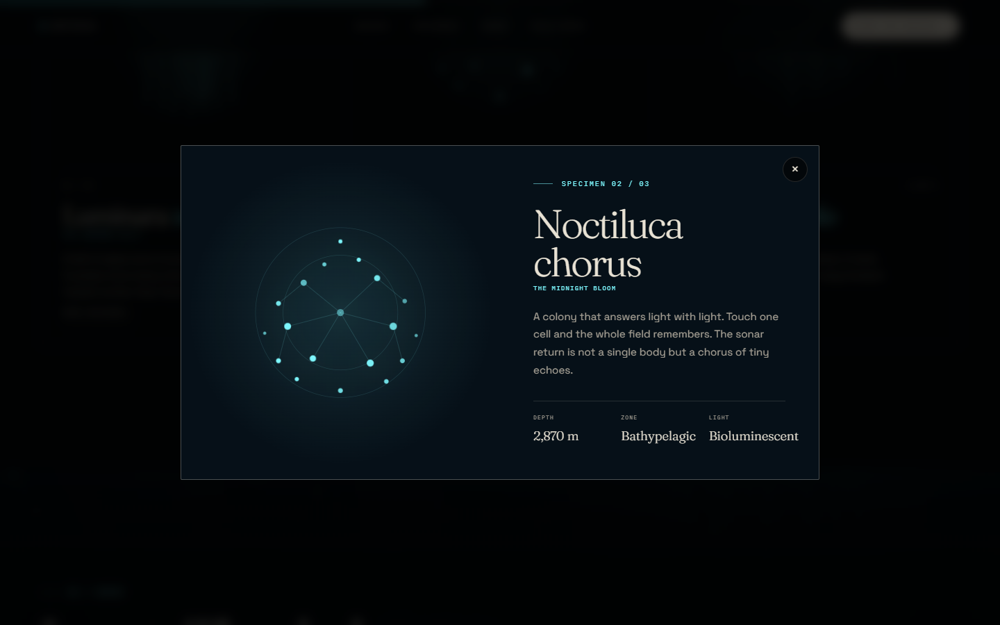
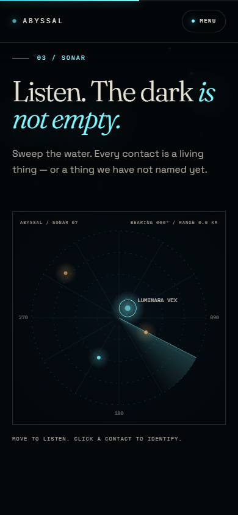
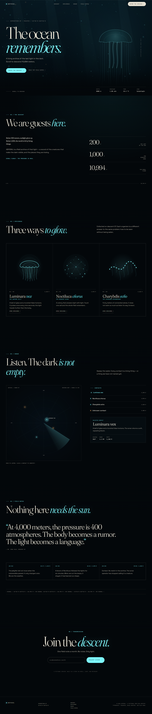

<div align="center">

# ABYSSAL

**The ocean remembers.**

A fictional deep-sea archive, built as a single-page scroll experience.

[**Live demo**](https://scarff2005.github.io/abyssal/) · [Screenshots](#screenshots) · [Run locally](#run-locally)


</div>



## The idea

Most AI website demos bolt a generated video onto a hero and stop there. I wanted the motion to be **structural** instead: the page itself should behave like a descent.

Scroll from the surface to **10,994 meters**. The scroll position becomes depth, pressure, temperature, and zone. The hero's inhabitants change as you go — a jellyfish near the surface, a siphonophore in the midnight zone, an anglerfish in the abyss. The sonar is not decoration: you can sweep it, hover a contact, click it, and read its bearing, range, and depth.

The constraint was restraint: one accent color, one serif, one mono, no stock photography, no video files. Every visual is drawn with CSS, SVG, or canvas. The depth math is real; the organisms are invented.

## What's inside

- **Canvas hero** — particles, light shafts, a pulsing jellyfish, a siphonophore, an anglerfish, and pointer parallax.
- **Live dive HUD** — depth, pressure, temperature, and zone update from scroll position.
- **Specimens** — three animated SVG organisms; each opens into a field-note dialog.
- **Sonar** — animated sweep, hover bearing/range readout, clickable contacts, and selection pings.
- **Field notes** — a large pull quote, three log entries, and a coordinate marquee.
- **Mobile menu** — full-screen editorial menu below 900 px.
- **Transmission form** — local-only confirmation; nothing is sent.
- **Reduced motion** — canvas motion and transitions collapse to a static composition.
- **No JavaScript** — reveal states are forced visible via a `<noscript>` fallback.

## Screenshots

| Desktop | Mobile |
| --- | --- |
|  |  |
|  |  |
|  |  |

<details>
<summary><strong>Full-page capture</strong> (long image)</summary>



</details>

More captures — including the sonar selection ping, field notes, and tablet layout — are in [`screenshots/`](screenshots/).

## Run locally

No build step. No dependencies. The site is plain HTML, CSS, and JavaScript.

### VS Code

1. Open this folder in VS Code.
2. Press **Ctrl+Shift+B** (Run Build Task).
3. The local server starts and your browser opens `http://127.0.0.1:4180`.
4. Press **Ctrl+C** in the terminal to stop the server.

The task lives in [`.vscode/tasks.json`](.vscode/tasks.json). `ABYSSAL.code-workspace` opens the project with its settings.

### Terminal

```powershell
git clone https://github.com/Scarff2005/abyssal.git
cd abyssal
python -m http.server 4180 --bind 127.0.0.1
```

Open `http://127.0.0.1:4180`.

### No server

You can also double-click `index.html`. It runs directly from disk because the site has no module imports or fetch calls. The local server is only there to mimic a real web host.

## Project structure

```text
abyssal/
├─ index.html              # structure, copy, specimen SVGs, dialogs
├─ styles.css              # type system, layout, motion, responsive states
├─ main.js                 # hero canvas, sonar, depth telemetry, dialogs
├─ screenshots/            # desktop, tablet, and mobile captures
├─ .vscode/tasks.json      # one-key local server
├─ ABYSSAL.code-workspace  # optional VS Code workspace
├─ .nojekyll               # serve static files directly on GitHub Pages
└─ README.md
```

## How it works

- The hero uses a fixed `<canvas>` with a 2D context. Particles, light shafts, jellyfish tentacles, the siphonophore, and the anglerfish are drawn procedurally. The animation stops once the hero is out of view.
- The depth HUD maps page scroll progress to 0–10,994 m and derives pressure (`1 + depth / 10`), temperature, and the depth zone.
- The sonar is a second canvas with a conic sweep, contact bearings, hover hit-testing, and expanding selection rings. The contact list is the keyboard-accessible equivalent.
- Specimens are inline SVGs animated with CSS. Opening one clones the SVG into a native `<dialog>` and fills in its field data.
- The mobile menu, specimen dialog, and skip link use native dialog/semantic patterns with visible focus states.
- `prefers-reduced-motion` is respected in both CSS and JavaScript.

## Accessibility & QA

- Checked at **1440, 900, 390, and 320 px** wide.
- No horizontal overflow; console clean at all four sizes.
- Keyboard-friendly dialogs, skip link, and visible `:focus-visible` rings.
- Reduced-motion and no-JavaScript fallbacks.
- All visuals are code; the only network requests are the three font families.

## Credits

- Type: [Fraunces](https://fonts.google.com/specimen/Fraunces), [Space Grotesk](https://fonts.google.com/specimen/Space+Grotesk), and [IBM Plex Mono](https://fonts.google.com/specimen/IBM+Plex+Mono) via Google Fonts.
- Concept, copy, code, and illustrations: Sibusiso Dlamini.

## Usage

This is a portfolio piece. The code is shared for viewing and learning; the writing and artwork are original. Please don't republish the site or its assets as your own.
